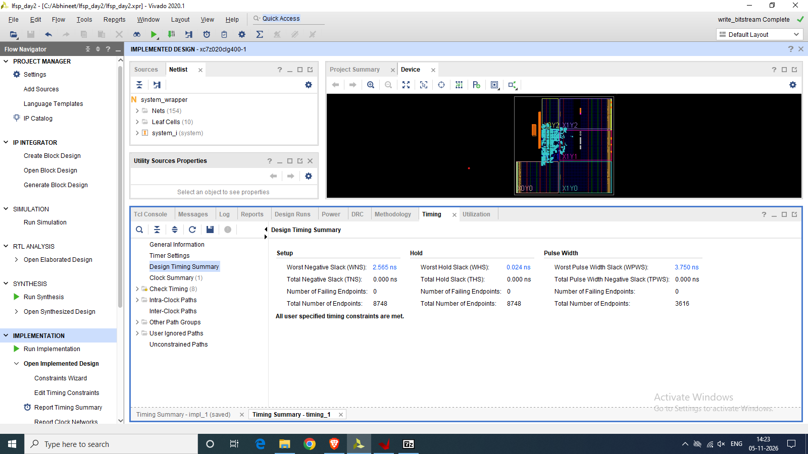
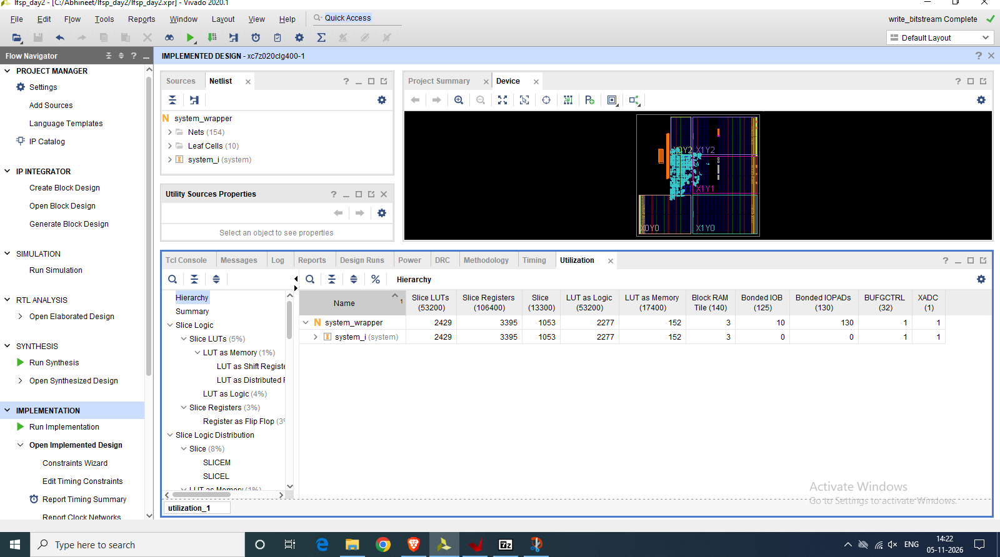

# Day 2 results — data-path hardware built (2026-11-05)

The Day 1 design plus XADC AXI4-Stream → `axis_src_mux` (XADC or `axis_test_pattern`) → `decim_avg` → AXI4-Stream Data FIFO (1024) → AXI DMA (S2MM, simple mode) → HP0 → DDR, with the DMA interrupt on IRQ_F2P and two AXI GPIOs for control and status. Built by [`Vivado_Scripts/day2_add_datapath.tcl`](../../Vivado_Scripts/day2_add_datapath.tcl) on a copy of the Day 1 project; hardware export in [`Hardware_Exports/day2`](../../Hardware_Exports/day2).

## Timing (100 MHz, FCLK_CLK0)

| | Value |
|---|---|
| Worst negative slack (setup, WNS) | **+2.565 ns** |
| Worst hold slack (WHS) | +0.024 ns |
| Worst pulse width slack | +3.750 ns |
| Failing endpoints | 0 of 8748 |
| Verdict | All user-specified timing constraints are met |

## FPGA resources (xc7z020clg400-1, whole design)

| Resource | Used | Available | Utilization |
|---|---|---|---|
| Slice LUTs | 2429 | 53200 | 4.6 % |
| — LUT as logic | 2277 | 53200 | 4.3 % |
| — LUT as memory | 152 | 17400 | 0.9 % |
| Slice registers (flip-flops) | 3395 | 106400 | 3.2 % |
| Slices | 1053 | 13300 | 7.9 % |
| Block RAM tiles (36 Kb) | 3 | 140 | 2.1 % |
| DSP48 | 0 | 220 | 0 % |
| Bonded IOB | 10 | 125 | 8.0 % |
| BUFGCTRL | 1 | 32 | 3.1 % |
| XADC | 1 | 1 | 100 % |

No DSP blocks are used: the decimator needs only a 22-bit adder, and dividing by 1024 is a choice of output bits, not arithmetic. Most of the logic is Xilinx infrastructure (AXI interconnects, AXI DMA, GPIOs); the block RAM holds the 1024-deep stream FIFO and the DMA's internal buffering.

