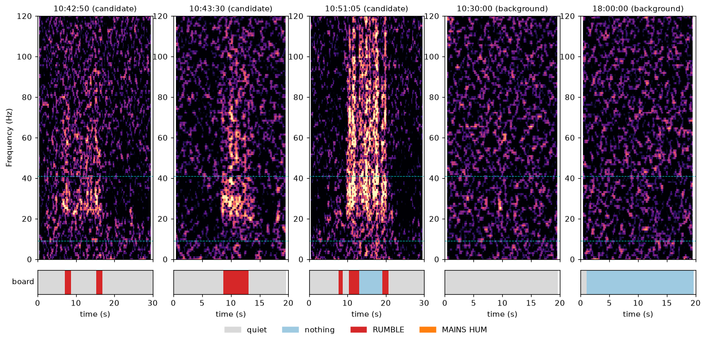

# Field recording: from real sound to the board (2026-11-09)

Recording: `nn01a_20220530_000000.wav` from the Elephant Listening Project (Cornell), 24 h, mono, 8 kHz, 16-bit — the voltage of a field microphone, digitised. Not stored in this repo (1.4 GB).

Tools: [`Signal_Processing/field_recordings/`](../../Signal_Processing/field_recordings/)

## 1. What the forest background looks like

Averaged over 3,000 blocks spread through the day, the background is close to **white from 9 Hz to 469 Hz** (≈ 93 dB/Hz in every sub-band), with most of the total power (insects, birds) at 1–4 kHz.

| Quantity over all 168,634 blocks (0.512 s each) | Value |
|---|---|
| Median rumble-band share (9–41 Hz of 0–469 Hz) | 85 ‰ |
| 99.9th percentile | 259 ‰ |
| Blocks reaching the board's 600 ‰ threshold | **1** |

The 9–41 Hz band is only 32 of 460 Hz, so broadband noise alone gives ≈ 7–9 %. For the board's share rule to fire on the **raw** recording, a rumble would have to exceed all the noise in 0–469 Hz by ≈ 12 dB. In addition, insect noise at 1–4 kHz aliases into 0–469 Hz through the boxcar decimator (only ≈ 13 dB attenuation at 1.4 kHz).

## 2. Finding candidate events

`find_rumbles.py` + an energy detector: rumble-band power ≥ 6 dB above its 10-minute background **and** ≥ 6 dB above the change in a 60–200 Hz reference band (rejects broadband impulses), for ≥ 2 blocks → 29 events ([`rumble_candidates.csv`](rumble_candidates.csv)). Whitened spectrograms were inspected by eye; most are short broadband impulses. The strongest tonal candidates are around **10:42:55–10:43:10** and **10:43:44–10:43:50** (≈ 22–35 Hz with harmonics, several seconds — rumble-like) and **10:51:10–10:51:30** (strong, broader; rumble chorus or vehicle). Species is **not** confirmed; listen at 8× speed (20 Hz → 160 Hz) to check.

## 3. What the unchanged board would report

`make_playback_clips.py` reconstructs each clip at the XADC rate, maps it to ADC codes (bias ≈ 650, full scale ±400 codes), decimates bit-exactly and runs the reference model of `lfsp_dsp.c`. One common gain per version. Full output: [`board_prediction.txt`](board_prediction.txt).

| Clip | raw | rc68 (1st-order 68 Hz) | lp60 (4th-order 60 Hz) |
|---|---|---|---|
| 10:42:50 candidate | no RUMBLE (max 450 ‰) | RUMBLE, 6 blocks | RUMBLE, 12 |
| 10:43:30 candidate | no RUMBLE (393 ‰) | RUMBLE, 8 blocks | RUMBLE, 10 |
| 10:51:05 candidate | no RUMBLE (583 ‰) | RUMBLE, 10 blocks | RUMBLE, 26 |
| 10:30:00 background | quiet | quiet | quiet |
| 02:00:00 background | quiet | quiet | quiet |
| 18:00:00 background | nothing | nothing | **false RUMBLE, 18 blocks** |

- Raw: missed — broadband and aliased noise dilute the band share.
- A first-order front-end low-pass at ≈ 68 Hz: candidates detected, no false alarms.
- Too narrow a front end: background noise alone fills the band and crosses 600 ‰.
- A laptop output that rolls off below 20 Hz would weaken detection (`+hp20` rows); into the ≈ 5 kΩ bias network the real roll-off is expected to be much lower.

## 4. Clips for playback

`clips/elp_<HHMMSS>_<dur>s_{raw,rc68}.wav` — 8 kHz, 16-bit mono, 0.5 s fades, one common gain per version. Play the **rc68** versions for detection; the **raw** versions show why a front-end filter is needed.

Playback circuit: laptop headphone out → 10 µF → bias node (10 kΩ to 3.3 V, 10 kΩ to GND) → existing 1.2 kΩ → A0; laptop volume high but not clipping; audio "enhancements" off; board program `day45_detect` with SW0 = 1.
